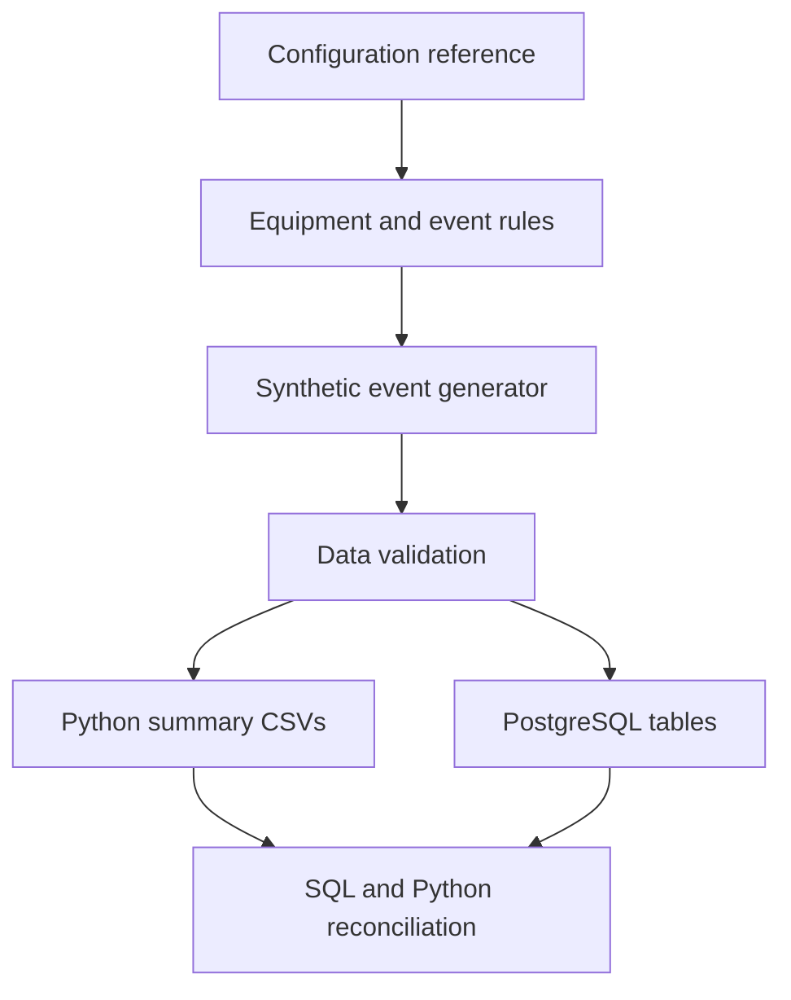

# Cable Cutting Machine Setup & Downtime Analysis

A Python + PostgreSQL portfolio project inspired by my work as a Cable Cutting Machine Setter and Operator (seřizovač–střihač), connecting cable-processing experience with manufacturing analytics. All event IDs, machine IDs, timestamps, durations, and actions are synthetic. No employer name, production records, internal manuals, or settings are bundled.

## Questions this project answers

- Which recorded symptoms account for the most unplanned-stop minutes?
- Which physical sections need closer investigation?
- How do the sample events differ by shift and machine configuration?
- Can Python and PostgreSQL produce matching results from the same validated data?

**Stack:** Python standard library · PostgreSQL · CSV · GitHub Actions.  
**Sample:** five PowerStrip 9500 line configurations, 1,000 fictional events, 13 Python regression tests.



## Start here

Python 3.10 or later; Python scripts need only the standard library. From the project folder:

```bash
python generate_data.py
python analyze_data.py
python -m unittest discover -s tests -v
```

Defaults: 1,000 events, seed 42. To experiment:

```bash
python generate_data.py --count 1500 --seed 7
python analyze_data.py
```

Generation replaces the two generated files `data/synthetic_machine_events.csv` and `data/event_rules.csv`. Configuration reference data is maintained separately. The analyzer validates the files before writing five summary CSVs to `reports/`.

## Five configuration types

All five start with **cable feeder / unwinder → V-loop buffer → letter marking**. The remaining sequence is:

| ID / machine | Remaining sections, in order | Evidence status |
|---|---|---|
| SIM-CONFIG-01 / SIM-CUT-01 | CSU → TEZA → Schleuniger PowerStrip 9500 → integrated KUKA / paper-taping / cable-stand cell | User-supplied experience example |
| SIM-CONFIG-02 / SIM-CUT-02 | TEZA → Schleuniger PowerStrip 9500 → Schleuniger CableCoiler 1300 | User-supplied experience example; no CSU |
| SIM-CONFIG-03 / SIM-CUT-03 | CSU → TEZA → Schleuniger PowerStrip 9500 → Schleuniger WireStacker 1000 | User-supplied experience example |
| SIM-CONFIG-04 / SIM-CUT-04 | TEZA → Schleuniger PowerStrip 9500 with rotary box → active offloader | Hypothetical training variant; no CSU |
| SIM-CONFIG-05 / SIM-CUT-05 | CSU → TEZA → Schleuniger PowerStrip 9500 with rotary box → passive offloader | Hypothetical training variant |

The official PowerStrip 9500 family specification lists rotary stripping as a model-dependent module (for example, RSL/RS/RX). For this portfolio, the user has confirmed that the installed PowerStrip 9500 cutters in all five modeled lines have a rotary box. Therefore every configuration records `rotary_box=present` and uses the explicit rotary equipment code. Configurations 1–3 are user-supplied examples; configurations 4–5 remain synthetic layout variants.

### Equipment functions

| Equipment | Short description |
|---|---|
| Cable feeder / unwinder | Supplies cable from a reel. |
| V-loop cable buffer | Buffers cable between stages. |
| Letter-marking machine | Applies identification text; exact printer model unspecified. |
| CSU | Center-strip processing, following the user's functional description; model unspecified. |
| TEZA | Transfer-ribbon marking, following the project description; full model unspecified. |
| PowerStrip 9500 | User-confirmed cut-and-strip model in all five configurations. |
| PowerStrip 9500 with rotary box | User-confirmed capability in all five modeled configurations; model family documentation treats rotary stripping as configuration-dependent. |

| CableCoiler 1300 | Collects processed cable as coils. |
| WireStacker 1000 | Collects and stacks processed wires. |
| Integrated KUKA cell | Handles coiled cable, paper taping, and final placement on the cable stand as one collection cell. Its internal coiler model is unspecified; no CC1300 is assumed inside it. |
| Active/passive offloader | Generic collection options; specific models and interfaces are unconfirmed. |

The cable stand stays inside the integrated cell. KUKA placement is a normal operation, not a modeled fault. Door-locking faults have a higher synthetic weight inside that cell based on experience, not a measured failure rate. CAYMAN is software, not a physical section.

## Data model

- **`machine_configurations.csv`**: one row per installed section, with explicit equipment code, sequence, provenance, and rotary capability.
- **`event_rules.csv`**: permitted section/event-type/reason combinations. Generated from `model.py` and the configuration reference; do not hand-edit it.
- **`synthetic_machine_events.csv`**: one interval per machine activity. An unplanned-stop interval is attributed to one section and one recorded symptom.

`cause` is retained as a column name for compatibility, but it is a **recorded symptom or activity reason**, not a proven root cause. `action_taken` is illustrative text, not a repair procedure or evidence of an actual intervention.

Event definitions:

- `unplanned_stop`: elapsed interruption time, included in downtime summaries.
- `setup`: planned changeover or calibration; kept separate from unplanned downtime.
- `quality_check`: inspection activity; the model does not assume it stopped production.

See [the SQL relationship diagram](sql/schema_diagram.md) and [the review/change report](REVIEW.md).

## Timeline assumptions

- Sampling window: 1 September 2026 at 06:00 through 1 October 2026 at 06:00, local Czech time, with no DST transition inside the window.
- Morning shift: 06:00–18:00. Night shift: 18:00–06:00 next day. `shift_date` is the date the shift **starts**, including for events after midnight.
- Each synthetic event fits wholly inside one shift. Real cross-shift stops would require splitting duration across shifts while retaining a parent incident ID; that is not implemented here.
- Events for the same machine do not overlap. This deliberately simplifies simultaneous faults and parallel inspection activities into one activity timeline.
- The window is a sampling range, **not** a documented production calendar. Gaps between events do not establish operating time or planned production time.
- One fixed configuration is assigned per machine for this dataset. Historical reconfiguration and effective dates are future work.
- Machines, sections, event types, and durations use illustrative sampling distributions. Event counts and stop times do not represent observed performance.

## Validation and reports

Validation rejects missing/malformed fields, duplicate IDs, duplicate section/sequence assignments, invalid process order, inconsistent equipment capabilities, invalid event-type/reason combinations, incompatible collection equipment, missing installed sections, wrong shifts/dates, inexact durations, and overlaps. Editing equipment display text cannot change capabilities.

Outputs in `reports/` summarize unplanned stops by section, recorded reason, shift, configuration, and shift date. They include counts, minutes, mean stop duration, downtime share, and cumulative share. Tables are ordered by minutes for Pareto-style analysis, including the date table; sort by date when plotting a trend. All five summaries reconcile to the same total.

**Interpretation limits:** do not label mean stop duration as MTTR (it can include waiting and diagnosis). Do not calculate OEE, availability, MTBF, defect rate, or an equipment reliability ranking from this dataset alone. Planned production time, genuine operating exposure, production counts, and quality outcomes are absent. A longer total downtime on one configuration does not establish that its design is worse.

## PostgreSQL

The schema is v2 and requires **a new database**, preserving any old practice database:

```bash
createdb machine_downtime_v2
psql -d machine_downtime_v2 -f sql/schema.sql
psql -d machine_downtime_v2 -f sql/load_data.sql
psql -d machine_downtime_v2 -f sql/analysis_queries.sql
```

Run these commands from the project root so CSV paths resolve. Three tables use composite foreign keys to constrain section membership and event rules. Shift and exact-duration rules are database checks. The import runs as one transaction with stop-on-error and a batch overlap check; errors roll back the import. Loading again into populated tables fails on duplicate keys without replacing existing data. The v2 schema is not an in-place migration of v1.

**Verification boundary:** Python generation, validation, and regression tests were executed. A PostgreSQL server/client was unavailable in the editing environment, so SQL execution is still a required local verification step. Python additionally checks configuration ordering, equipment/section mapping, rule catalog consistency, and fixed configuration per machine. Database foreign keys trust the imported rule catalog. The import's overlap check is not a concurrency-safe database constraint on future direct inserts; run Python validation for the intended CSV workflow.

## Suggested learning sequence

1. Run the project and explain one row using its configuration and event rule.
2. Inspect `tests/test_project.py`: introduce a wrong collection cause and observe rejection.
3. Load a fresh PostgreSQL database and reproduce Python totals with the SQL queries.
4. Import the CSV summaries into Power BI; label every visual as synthetic.
5. Add production calendars and production/quality counts before attempting availability or OEE.

The implementation stays within Python's standard library to keep setup manageable. `model.py` centralizes rules; the SQL rule table makes those rules explicit in database practice. A future larger project could normalize machine, configuration history, and equipment dimensions further.

## Automated verification

`.github/workflows/validate.yml` defines checks for pushes and pull requests. It runs the Python tests, checks that generated CSVs and reports reproduce exactly, starts PostgreSQL 16, imports the dataset, then compares five SQL aggregates against Python and checks four rejected inserts. A workflow definition is not evidence of a successful run: inspect the repository's Actions tab for the actual result.

After loading a disposable local database, set the standard PostgreSQL connection variables (`PGHOST`, `PGPORT`, `PGUSER`, `PGDATABASE`, and a password through your preferred local mechanism), then run:

```bash
python scripts/verify_postgres.py
```

The script verifies counts, all five aggregates, duration checks, shift checks, reason/type constraints, and rollback of invalid inserts. Test database credentials in the workflow apply only to its ephemeral PostgreSQL service.
