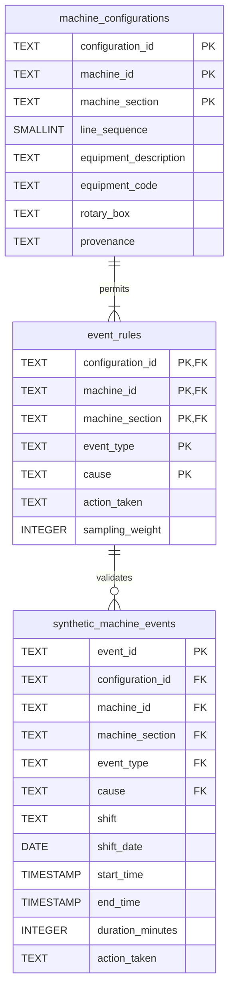

# Database schema — v2

- Configuration key: `(configuration_id, machine_id, machine_section)`; sequence also unique within machine/configuration.
- Rule key: `(configuration_id, machine_id, machine_section, event_type, cause)`.
- Each event references **one composite rule key**. The five FK labels do not mean five independent relationships.
- Rule `action_taken` is the generator's default; event `action_taken` is the illustrative recorded action.
- Explicit capabilities and equipment codes replace substring matching of descriptions.
- SQL checks enforce positive exact durations, shift boundaries, and basic capability consistency. Python validates configuration order and the permitted rule catalog.
- The loader checks overlaps once per imported batch; the schema alone does not prohibit future concurrent overlapping inserts.
- No configuration history, production exposure, or production/quality quantities are modeled.

Executable definition: [schema.sql](schema.sql). CSV import: [load_data.sql](load_data.sql).
